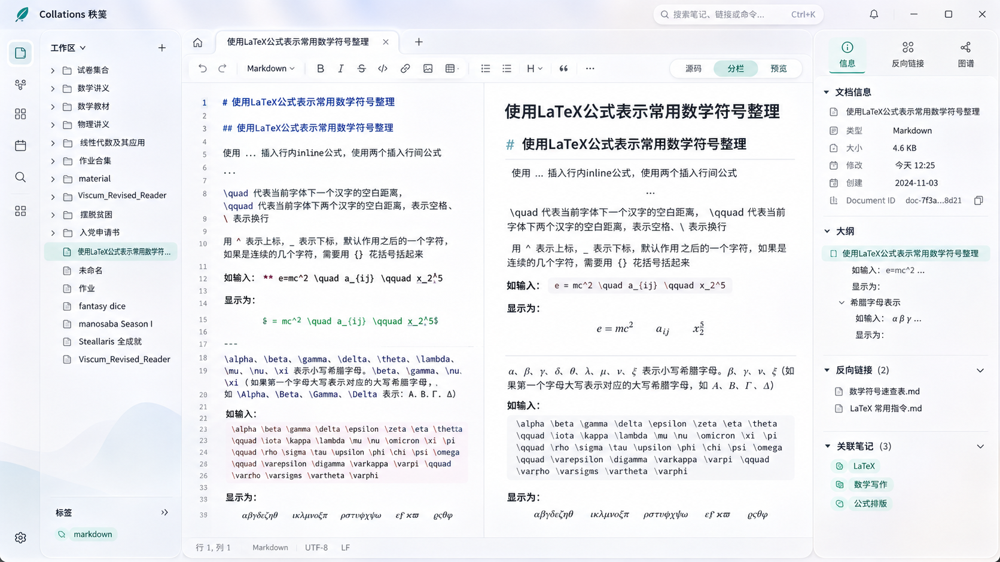

# Collations Windows UI 重构与 v0.3 知识导航

状态：待实现与验收的规范；不表示已交付。2026-11-06 整理，以用户最终确认的 A–F 计划为准，早期粘贴附件不覆盖本规范。

参考图来源：用户提供的设计参考；原样保存，未重绘或编辑。SHA-256：`4950582d52d3baf0c5c6231955ab912ae15e964ef1c251fb6f639e38e24ecd39`。图中示例文件、数量和标签不作为真实数据；图谱入口仅按实际能力展示。

## A–B：保留现有行为，建立设计系统

保留 v0.2 CodeMirror 会话、撤销历史、选区、自动保存、草稿恢复、Manifest v3 和安全写盘。先将活动文档、标签状态和命令从页面布局分离。每标签持有独立编辑器实例；主题、分栏、侧栏变化保持挂载。保留原生 Markdown 和原始字节，不另创文档语言。

集中管理颜色、字体、间距、圆角、焦点、阴影、动效。浅色以白、蓝灰和青绿为主；深色独立定义正文、代码高亮、公式错误和选中态。默认浅色，设置支持浅色、深色、跟随系统并在本机记忆。标题区、命令面板和浮层局部玻璃效果，支持不透明降级；正文和公式区实色。普通过渡从 160ms 起步，遵从 prefers-reduced-motion；拖动即时更新。

## C–D：五区布局与真实编辑器

宽屏以导航轨及文件树约 18%、中央写作区 63%、右栏 19% 为参考，源码与预览接近等宽，共用标签栏和工具栏。白色正文占最大面积，蓝灰层次位于窗口边缘，青绿标记当前文件、视图和面板。

| 区域 | 必须实现与验证 |
|---|---|
| 顶部品牌、搜索与标签 | 保留 Windows 原生窗口控制；顶栏 Collations 标识和 Ctrl+K 入口；标签反映名称、活动及未保存状态；每个可用工具栏按钮调用真实命令，格式操作可撤销。 |
| 左侧导航轨 | 工作区、知识关系、搜索、设置入口；研究项目和文献库明确预留；统一线宽矢量图标，文字提示和键盘焦点。 |
| 文件树 | 真实目录清单，含文件夹、空目录及 Markdown；折叠、筛选、高亮、状态、长名称提示、右键菜单。新建文档复用独立 ID 登记；新建文件夹由受工作区边界校验的原生命令执行。 |
| 写作区 | 默认源码/预览分栏，拖动及键盘调整比例；源码、分栏、预览模式；状态栏实际行列、编码和换行，混合换行单独标示；定理/证明沿用作者标题、引用和强调。 |
| 右栏 | 默认文档信息、大纲、反链；大小和修改时间取自文件系统，ID 可复制；创建时间仅在来源可靠时展示；大纲跟随当前缓冲区，可点击定位标题。 |

以 CSS 可用宽度决定布局：中央不足以容纳舒适两栏时先收起右栏，再将文件树变抽屉。允许手动隐藏侧栏和专注模式。分别处理窗口尺寸、系统缩放与分栏偏好，避免高缩放正文过窄。

## E：命令、冲突与恢复

Ctrl+K 打开命令面板：搜索文档、筛选当前可执行命令、方向键选择、Enter 执行、Esc 返回原焦点。右键菜单复用同组命令及可用条件。

外部修改提示明确文件及自动保存状态。比较窗口并列显示基线、本地草稿、磁盘版本并突出变化行，提供重新加载和另存为。替换竞争产生的外部备份单独显示路径，不把当前磁盘内容当作被替换版本。

恢复窗口显示路径、持久化时间、草稿预览和与磁盘的关系；兼容 v0.2 草稿及校验方式，旧记录缺少时间时显示“未记录”。恢复、另存副本、关闭窗口的结果清晰。不得静默覆盖外部内容。

## F：知识链接与导航

Core 从语法树提取标准文档链接、引用式链接、标题和显式块锚点，兼容常见 WikiLink、别名、块引用读取；跳过代码块及行内代码。每条链接记录来源 Document ID、源码位置、原始目标及解析状态：已解析、目标缺失、锚点缺失、同名歧义。

Desktop 将已保存文档链接写入可重建 SQLite 派生表；入边查反链、出边查关联文档。变更、移动、删除时重新解析受影响来源与目标。右栏明确区分“当前缓冲区大纲”与“最近保存版本关系索引”。

点击链接打开真实文档并定位标题/块；悬浮和键盘聚焦显示摘录；反链跳回来源位置。移动后仅在旧目标身份可确认时提出路径修复建议；展示修改前后文本，由用户确认并重新校验源文件哈希后执行。歧义保持诊断。

知识关系入口交付可导航的真实入链和出链列表；不以静态示例冒充图谱能力。

## 验收与交付

1. **功能回归：** 运行既有 core、原生存储及三个打包程序回归。新增文件树操作、命令面板、标题定位、WikiLink 歧义、反链更新、移动修复确认、SQLite 删除重建测试。主题切换和拖动分栏前后，未保存正文、光标、选区与撤销历史一致。
2. **视觉与键盘：** 同一真实中文数学工作区生成浅/深色截图，逐项对照五区比例、标签层次、选中态和公式留白。覆盖宽/中/窄窗口及 Windows 100%、125%、150% 缩放；键盘调分栏、浮层焦点恢复、减少动画及关闭玻璃效果。
3. **性能与输入法：** 同一 Windows 机器、同一大型 Markdown 对比 v0.2 与新版，记录输入至显示延迟、预览更新时间、拖动及静置 CPU/GPU。仅为可见预览执行必要解析。中文 IME 单独测试组合、选词、取消、提交；确认组合期磁盘正文不变，并注明是否真人完成。
4. **发布：** 从经核实的基线提交 core 链接解析、desktop UI/索引集成、docs 规范与 ADR 的堆叠 PR，不自动合并。交付 Windows x64 Release、SHA-256、真实截图、测试记录、已知问题与后续建议。

当前实现及历史验收见 [总交接](../../HANDOFF.md)。core 链接基础已提交；desktop 完整 v0.3 UI、关系索引及上述验收尚未完成。新实现必须分别报告已实现、已测试、尚未验证和已知问题。

